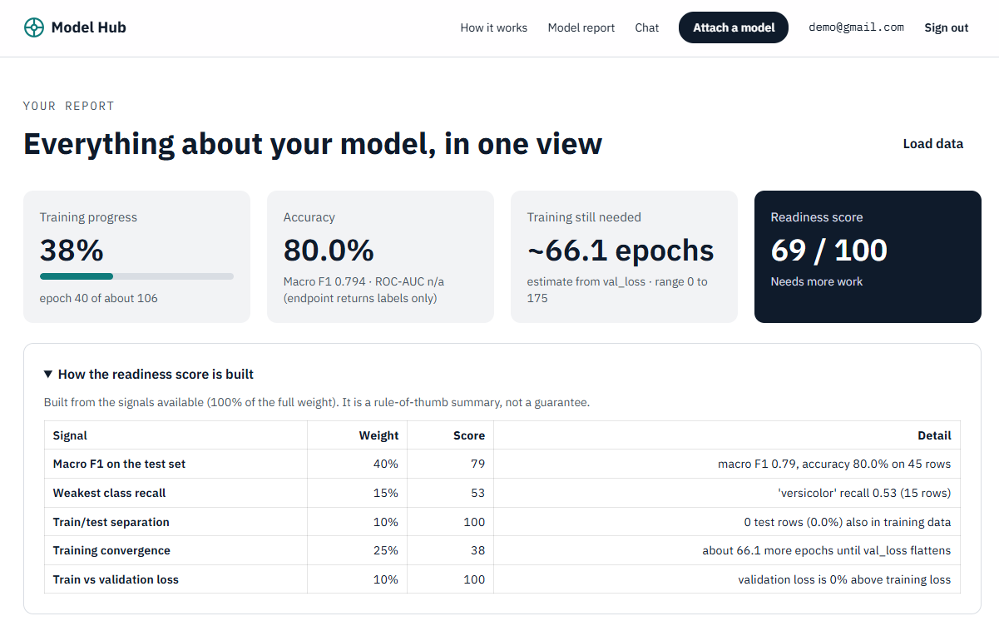
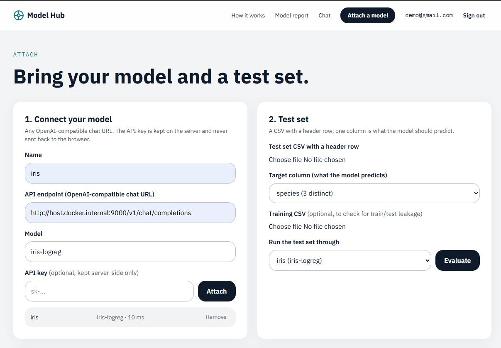
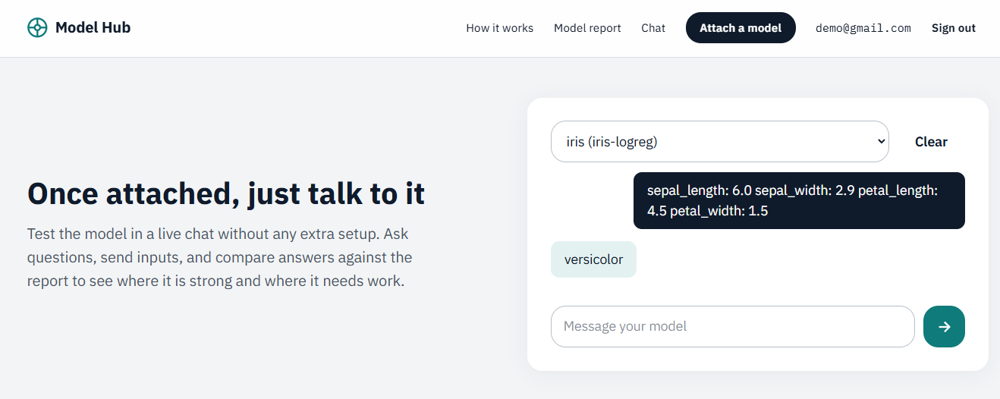
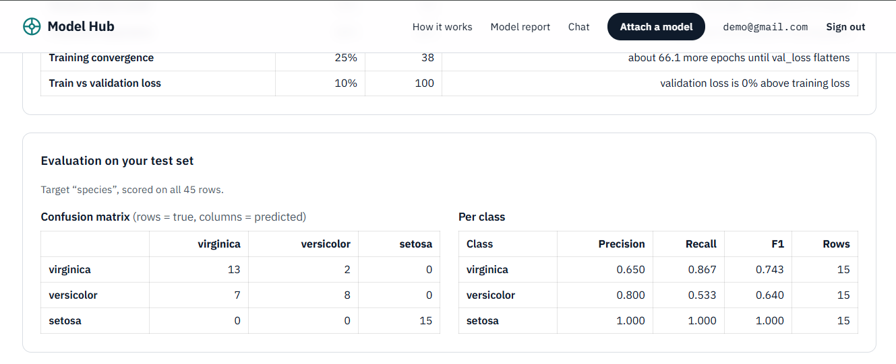
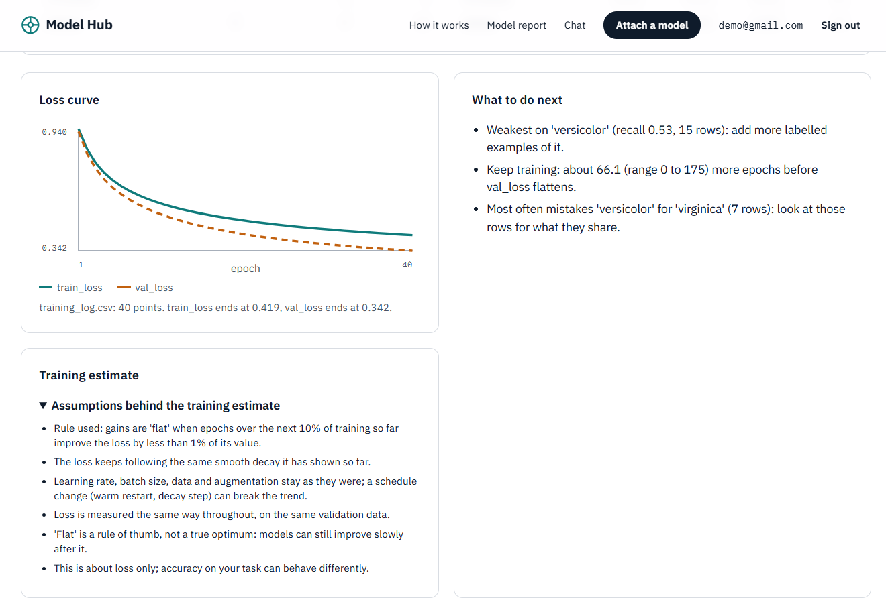

# Model Hub

Attach a model, test it on your own data, and see how ready it is.

Model Hub is a web app that scores an AI / ML model without you writing evaluation code. Point it
at any OpenAI-compatible endpoint, upload a labelled test set, and it reports accuracy, F1, a
confusion matrix and a readiness score, tells you what to fix next, and lets you chat with the
model in the browser.



## What it does

- **Attach a model:** any OpenAI-compatible chat endpoint (your own server, Ollama, a hosted API). The URL is probed when you attach it, and API keys are stored encrypted on the server.
- **Evaluate:** upload a CSV test set and choose the target column. Every row is sent to your model and the replies are scored: accuracy, macro F1, per-class precision and recall, and a confusion matrix.
- **Check for leakage:** optionally upload the training CSV and Model Hub warns if training and test rows overlap, since that makes scores look better than they are.
- **Training progress:** upload a training log (a CSV, or an MLflow run) to get a loss curve, how far along training is, and a rough estimate of the training still needed, with its range and assumptions shown.
- **Readiness score:** a 0-100 score built from whatever signals you have loaded, with a "what to do next" list. It says how many of its signals it is based on.
- **Chat:** talk to the attached model in the browser, with streamed replies.
- **Upload weights:** `.safetensors` and `.gguf` files are scanned and stored. GGUF models can be run in a locked-down container; safetensors files are stored but cannot be run yet.

| Attach a model | Chat |
|---|---|
|  |  |

| Confusion matrix | Loss curve |
|---|---|
|  |  |

## Run it with Docker

You need Docker Desktop.

```bash
docker compose up -d --build --wait     # PostgreSQL + API + web; the first build takes a few minutes
```

Open http://localhost:3000 (the API is on http://localhost:8001). Nothing needs configuring. Create
an account, and everything you add is private to it.

- Stop it with `docker compose down` (keeps your data). Add `-v` to delete the database, uploads and keys too.
- To attach a model running on your own machine, set `ALLOW_PRIVATE_ENDPOINTS=1` before starting
  (PowerShell: `$env:ALLOW_PRIVATE_ENDPOINTS = "1"`). Because the API runs inside Docker, use
  `host.docker.internal` instead of `localhost` in the endpoint URL.

Settings, ports and the non-Docker setup are in [docs/DEVELOPMENT.md](docs/DEVELOPMENT.md).

## Try it with the example model

[example-model/](example-model/) is a small iris-species classifier you can run in a minute. It
trains epoch by epoch, so it also produces a training log.

```bash
cd example-model
pip install scikit-learn pandas joblib fastapi uvicorn safetensors
python train.py                          # writes the model, train.csv, test.csv, training_log.csv
python -m uvicorn serve:app --port 9000  # serves it as an OpenAI-compatible endpoint
```

Then in Model Hub:

1. **Connect page, Attach a model:** name `iris`, URL `http://host.docker.internal:9000/v1/chat/completions`
   (or `http://localhost:9000/...` if the API runs on your machine), model `iris-logreg`, no key.
2. **Test set:** upload `test.csv` and choose `species` as the target. Optionally upload `train.csv` as the training set.
3. **Training log:** upload `training_log.csv`.
4. **Evaluate**, then open **Model report**. In the Chat page, send `sepal_length: 6.0 sepal_width: 2.9 petal_length: 4.5 petal_width: 1.5`.

The model is deliberately stopped early, so the report shows a model that still needs training.
Raise `EPOCHS` in `train.py` for a stronger one.

## How it keeps you safe

- **Pickle-based files are refused.** Formats like `.pt`, `.pkl` and `.bin` can run code when loaded, so only `.safetensors` and `.gguf` are accepted, and each file is checked by structure on the server rather than by its name.
- **Uploaded GGUF models run in an isolated container** with no network, capped memory and a read-only filesystem.
- **Accounts are isolated.** Each user's endpoints, test sets, logs and weights are private, and another account's ids answer `404`.
- Passwords are hashed with argon2, sign-in attempts are throttled, and API keys are encrypted at rest.

Details and the security tests are in [docs/DEVELOPMENT.md](docs/DEVELOPMENT.md).

## Built with

Next.js and Tailwind (front end), FastAPI (API), PostgreSQL, scikit-learn (metrics and estimates),
and Docker Compose, with end-to-end tests of the whole stack.

## Known limits

- This is an MVP. A run scores at most 200 rows (a fixed random sample above that), and it runs inside the request.
- Chat endpoints return labels, not probabilities, so ROC-AUC shows as n/a.
- The "training still needed" figure is a rough extrapolation from a loss curve. Treat the range as the answer, not the single number.
- Weights & Biases logs are supported through their CSV export, not a direct import.
- Uploaded models cannot be started inside the all-Docker setup, because that would mean giving the API control of Docker. Run the API on the host for that (see the development notes).

## More

- [docs/DEVELOPMENT.md](docs/DEVELOPMENT.md): architecture, backend setup, tests, design notes and the project plan.
- [web/README.md](web/README.md): the front end.
